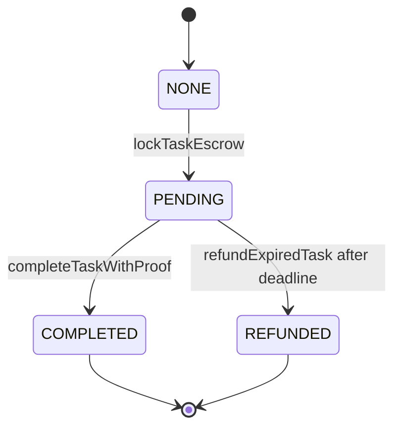
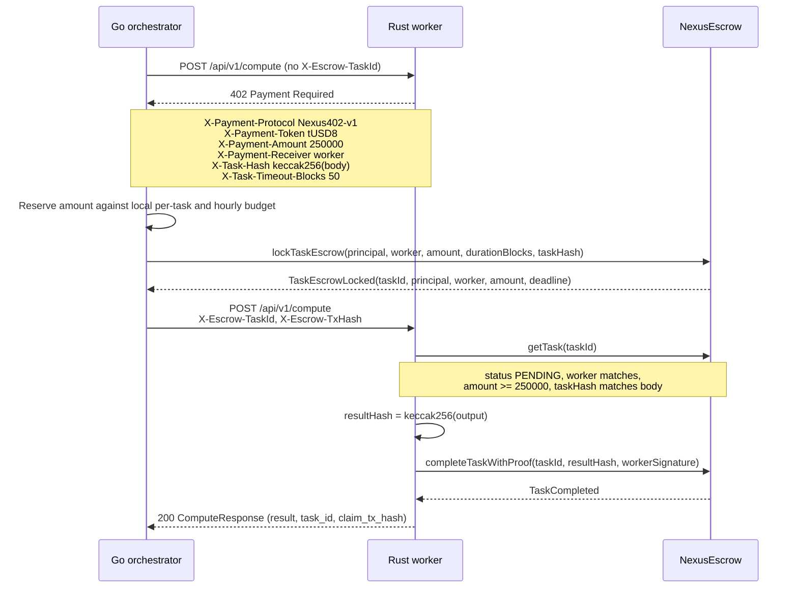

# Nexus402 architecture

Nexus402 is a four-process system on QDay Aevum Testnet (chain id `44005`). A human principal signs one EIP-712 session. A Go orchestrator then hires a Rust worker over HTTP 402. `NexusEscrow` holds tUSD8 (`0x456569838f1d43009A91ebA4263147Afd7233483`, 6 decimals) until the worker proves the result, or until the deadline block and a refund.

| Process | Role | Port |
| --- | --- | --- |
| Next.js command center | Session signature, tUSD8 approval, emergency revoke, mesh and terminals | 3000 |
| Go orchestrator | 402 client, four-goroutine job pool, `lockTaskEscrow` | 8081 |
| Rust worker | 402 challenge, escrow check, compute, `completeTaskWithProof` | 8080 |
| `NexusEscrow` | Session caps, escrow custody, proof check, refund, revoke | Aevum |

The orchestrator key pays gas for locks. The worker key pays gas for claims. tUSD8 moves `principal -> escrow -> worker`, or back to the principal on refund. The command center never stores the session private key.

## 1. Network topology and flow

### Escrow state machine

`EscrowStatus` is `NONE`, `PENDING`, `COMPLETED`, `REFUNDED`. A task id that has never been locked reads as `NONE`.



`COMPLETED` and `REFUNDED` are terminal. A second claim or refund reverts with `TaskNotPending`. A missing id reverts with `TaskNotFound`.

### HTTP 402 then on-chain settlement

The worker prices one `POST /api/v1/compute` at `250000` base units (0.25 tUSD8) and a timeout of 50 blocks. `X-Task-Hash` is `keccak256` of the raw request body.



`taskId` is not chosen by either agent. The contract derives it:

```text
taskId = keccak256(abi.encodePacked(
    principal,
    msg.sender,          // session agent key
    worker,
    taskNonce,           // _taskNonces[principal][agent], then incremented
    taskHash
))
deadline = block.number + durationBlocks
```

The orchestrator reads `taskId` from `TaskEscrowLocked` topic0 `keccak256("TaskEscrowLocked(bytes32,address,address,uint256,uint256)")`.

## 2. EIP-712 session delegation

The human wallet signs this type once. The agent key is only the recovered `agentKey` address, not a token holder.

```text
SessionAuthorization(
    address principal,
    address agentKey,
    uint256 hourlyLimit,
    uint256 perTaskLimit,
    uint256 expiresAt,
    uint256 nonce
)
```

`SESSION_TYPEHASH` is the keccak256 of that string. The struct hash is `abi.encode` of the typehash plus the six fields. `EIP712("Nexus402 Protocol", "1")` wraps it with `_hashTypedDataV4`. OpenZeppelin binds the domain separator to the contract's `name`, `version`, `block.chainid`, and `address(this)`. On Aevum that chain id is `44005`, so a signature produced for another chain or another escrow address does not recover to the principal.

`registerSessionWithSig` checks, in order:

1. `expiresAt > block.timestamp`, otherwise `SessionExpired`.
2. `principal` and `agentKey` are non-zero, otherwise `InvalidSignature`.
3. `nonces[principal]` is the nonce inside the struct. `ECDSA.tryRecover` on `(v, r, s)` must return `principal`, otherwise `InvalidSignature`.
4. `nonces[principal]` increments by one. The same signature cannot register again.
5. The session is stored with `currentWindow = block.timestamp / 3600`, `spentInWindow = 0`, and `isActive = true`.
6. `SessionAuthorized` is emitted.

`lockTaskEscrow` accepts only `msg.sender` equal to that session's agent key. The principal's ERC-20 allowance is what `safeTransferFrom` spends. The agent key has no transfer or withdraw function.

## 3. Double-spend and velocity guardrails

Limits are integer base units. One tUSD8 is `1000000`.

On each lock the contract loads `_sessions[principal][msg.sender]` and rejects the call unless `isActive` is true (`SessionInactive`), `block.timestamp < expiresAt` (`SessionExpired`), `amount > 0` (`ZeroAmount`), `worker != address(0)` (`InvalidWorkerAddress`), and `amount <= perTaskLimit` (`ExceedsPerTaskLimit`).

The hourly window id is integer division:

```text
window = block.timestamp / 3600
```

If `window` is greater than `currentWindow`, the contract sets `currentWindow = window` and `spentInWindow = 0` before testing the new amount. That is the top of the next 3600-second bucket. It does not pro-rate the previous hour. `spentInWindow + amount` must be `<= hourlyLimit` or the call reverts with `ExceedsHourlyLimit`. The addition is stored before `safeTransferFrom`. A failed transfer reverts the whole transaction, so the counter does not stick.

`perTaskLimit` does not reset with the window. A single lock can never exceed it, including the first lock of a new hour.

The orchestrator keeps a matching local budget (`PER_TASK_LIMIT`, `HOURLY_LIMIT`) and releases the reservation if the lock is not broadcast. The contract counter is the one that cannot be bypassed by a second process.

## 4. Machine compute proof

After compute, the worker hashes the output bytes with keccak256. The bond presented to the contract is:

```text
inner = keccak256(abi.encodePacked(taskId, resultHash))
digest = MessageHashUtils.toEthSignedMessageHash(inner)
```

That is the Ethereum signed-message prefix (`"\x19Ethereum Signed Message:\n32"` plus `inner`). The worker signs `digest` with its escrow key. The signature is 65 bytes, `r || s || v`, with `v` in `{27, 28}`.

`completeTaskWithProof` accepts the claim only when:

1. The task exists and `status == PENDING`.
2. `ECDSA.tryRecover(digest, workerSignature)` equals `task.worker`. Any other key reverts with `InvalidProofSignature`.
3. The contract writes `resultHash` and sets `status = COMPLETED`.
4. Only then does `safeTransfer` send `task.amount` of tUSD8 to `task.worker`.
5. `TaskCompleted` is emitted.

The recovered signer is the assigned worker for that task id, so a different node that saw the body cannot collect the escrow. The status write happens before the token move, and `nonReentrant` wraps the function, so a worker contract that tries to re-enter during `transfer` sees `COMPLETED` and is rejected.
